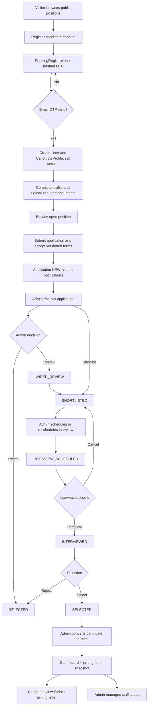

# Existing Application Workflow Audit

**Audit date:** 30 October 2026  
**Scope:** Source-code review of the existing repository. No build, test suite, browser session, live database, SMTP account, or Cloudinary account was run or accessed. Secret values were not read.  
**Status terms:** **EXISTING** means directly implemented in source; **PARTIAL** means some supporting data/UI exists but the requested end-to-end capability does not; **MISSING** means no supporting route, model, or workflow was found; **NOT VERIFIED** means source points to an integration or runtime behavior that cannot be confirmed from this inspection.

## 1. Executive Summary

This repository contains a Next.js 15 App Router application for recruiting permanent staff for wedding and event work. Its implemented business process is recruitment: candidates register and verify email, complete a profile, upload documents, browse positions, apply, track status and interviews, and view a joining letter after an administrator converts a selected candidate into a staff record. Administrators manage candidates, positions, applications, interviews, staff status, notifications, and their own account credentials.

It is **not** currently an event operations or event-planning platform. There are no client/planner, event, guest/RSVP, transport, room allocation, service catalogue, deployment, attendance, shifts, overtime, payroll, quotation, invoicing, expense, or client-contract modules in the inspected application source. The separate service agreement text currently in `README.md` is not connected to the recruitment data model or application workflows. The app has an application acceptance record and a joining-letter snapshot; these are candidate recruitment documents, not client service agreements.

| Inventory | Count / result |
|---|---:|
| Page routes (`page.tsx`) | 31 |
| API route files / endpoint paths | 24 |
| Exported HTTP method handlers | 35 |
| Mongoose models / collections | 9 |
| Main roles | 2: `CANDIDATE`, `ADMIN` |
| Third-party services referenced | MongoDB, Cloudinary, SMTP mail; Google Fonts in browser |

**Critical findings:** the central recruitment lifecycle is represented end-to-end; active role and ownership checks exist in API handlers; the application has no separate staff login/role; public company contact values in `lib/site.ts` are placeholders; there is no login or IP-based OTP throttling visible; signed file URL lifetime is not explicitly bounded in this code; and the present PWA service worker does not cache pages or data. A source-level mojibake/encoding issue appears in user-visible text and symbols across files. These findings describe source, not a live penetration, deployment, or visual test.

## 2. Project Architecture

### Technology and structure

- **Frontend:** React 19 and Next.js 15 App Router, TypeScript, server components by default, client components for interactive forms/actions, CSS Modules plus global CSS/Tailwind utility classes. `@/*` resolves from repository root.
- **Backend:** Next.js route handlers under `app/api`; shared API wrapper, JSON parsing, Zod validation, error responses and auth helpers in `lib/api.ts`. Server-rendered pages sometimes query Mongoose directly rather than calling their own API endpoints.
- **Database:** MongoDB through Mongoose 8. Connection is cached in `lib/mongodb.ts`. Models are declared in `models/index.ts`.
- **Authentication:** Candidate email verification via a six-digit OTP, bcrypt password hashes, HS256 JWT in an HTTP-only `session` cookie (7-day expiry), with `SameSite=Lax` and `Secure` in production. `middleware.ts` provides an initial route gate; page and API guards verify the live MongoDB user, active flag, and role again.
- **Validation:** Zod schemas in `lib/validators.ts`, plus Mongoose schema constraints and indexes. Shared API errors return a `{success,message,data?}` style envelope; Zod errors include field errors.
- **File storage:** Cloudinary authenticated assets. MongoDB stores file metadata and public IDs, not file bytes. `lib/cloudinary.ts` detects supported file types from bytes and enforces 3 MB photo / 5 MB document limits. `GET /api/files` checks the path and owner/admin role, then redirects to a signed Cloudinary URL.
- **Email:** Nodemailer SMTP is used for registration OTP only. Application/interview notifications are persisted in-app, not emailed by the inspected workflow.
- **PWA/SEO:** A web manifest, install prompt, robots and sitemap routes exist. The service worker only claims clients and activates immediately; it does not implement offline caching.
- **Other dependencies:** bcryptjs, jsonwebtoken, mongoose, nodemailer, cloudinary, zod; Vitest is configured with two test files. Tests were not run.

### Environment configuration names found in source

`MONGODB_URI`, `JWT_SECRET`, `CLOUDINARY_CLOUD_NAME`, `CLOUDINARY_API_KEY`, `CLOUDINARY_API_SECRET`, `SMTP_HOST`, `SMTP_PORT`, `SMTP_USER`, `SMTP_PASS`, `SMTP_FROM`, `SMTP_SECURE`, and `NEXT_PUBLIC_APP_URL`. `NODE_ENV` is also used. No values were read or copied into this report. `lib/site.ts` falls back to `http://localhost:3000` and contains placeholder email, phone and address values; deployment correctness is **NOT VERIFIED**.

### Frontend-to-backend pattern

Public/server pages use `lib/data.ts` or direct model queries. Interactive client components call `lib/client.ts`'s `api()` helper, which sends JSON or `FormData` and expects a JSON response. Server route handlers typically call `requireAuth`, `parseBody`, then Mongoose and `ok`/`fail`. Admin and candidate page layouts use `requirePage` and render the shared responsive `components/Shell.tsx` navigation. `lib/guard.ts` redirects wrong-role or unauthenticated page access. `middleware.ts` is a first gate, not the sole security control.

## 3. Complete Page & Route Inventory

The route count is 31 page files. Parentheses in `(site)` and `(panel)` are Next.js route groups and are omitted from browser URLs.

### Public and authentication pages — 8

| URL | Purpose / access | Data or actions |
|---|---|---|
| `/` | Public landing page | Promotional content and links; source does not establish a staff application itself. |
| `/about` | Public company/recruitment description | Static copy plus `SITE.name`; says permanent staff and fair hiring process. |
| `/contact` | Public contact/help page; also rendered in signed-in shell | Email/phone/address from `SITE`; copy and map links. Values are placeholders in source. |
| `/faq` | Public recruitment FAQs | Static `FAQS` in `lib/site.ts`. |
| `/jobs` | Public active position listing | Search/filter/sort and position cards; `listPublicPositions` reads `Position`. |
| `/jobs/[id]` | Public position details | Finds position by ID or slug; active/open positions are publicly browsable. |
| `/login` | Candidate login | Auth form calls `/api/auth/login`; `next` is accepted only when it begins with one `/`, otherwise role default is used. |
| `/register` | Candidate registration + OTP verification | Calls register, verify, resend endpoints; registration data is name, email, phone, password. |

### Candidate pages — 9

All `/candidate/*` pages require an active `CANDIDATE` account; candidate layout also reads unread notification count.

| URL | Purpose / actions | Data used |
|---|---|---|
| `/candidate/dashboard` | Candidate stats, recent activity, open positions, support links; redirects to profile setup if incomplete | Candidate `User`, `CandidateProfile`, `Application`, `Interview`, `Notification`, `Position`. |
| `/candidate/profile` | Four-step profile editor and saved summary; update profile and profile photo | `CandidateProfile`, `User`; profile/document APIs. |
| `/candidate/documents` | Upload, replace, view and delete profile documents | `CandidateProfile`; Cloudinary via documents/files APIs. |
| `/candidate/apply/[positionId]` | Review position, complete application and accept recruitment terms | Position plus candidate profile/documents; POST application API. |
| `/candidate/applications` | List/filter own applications | `Application`, populated `Position`; status/history summary. |
| `/candidate/applications/[id]` | Own application details, status timeline, interview details | `Application`, `Interview`; ownership is enforced in API for API fetches and page queries use candidate ID. |
| `/candidate/interviews` | Candidate interview schedule/list and status filtering | Own `Interview`, populated position. |
| `/candidate/notifications` | Read or mark all in-app notifications read | Own `Notification` records. |
| `/candidate/staff` | View/print joining letter after hiring conversion | Own `Staff.joiningLetter`; no staff shift, assignment, attendance or payroll UI. |

### Admin pages — 14

`/admin/login` is the admin login page; `/admin/*` panel pages require active `ADMIN` via middleware and `requirePage`.

| URL | Purpose / actions | Data used |
|---|---|---|
| `/admin/login` | Admin-only login form | `/api/auth/login` with `adminOnly: true`. |
| `/admin/dashboard` | Recruitment metrics, recent applications, upcoming interviews | Aggregates/counts over `User`, `Application`, `Interview`, `Position`, `Staff`. |
| `/admin/applications` | Search/filter/paginate application queue | `Application`, `User`, `Position`. |
| `/admin/applications/[id]` | Review profile/documents/agreement/history, update status/notes, schedule interview, convert selected candidate to staff | `Application`, `CandidateProfile`, `Interview`, `Staff`; mutation APIs. |
| `/admin/candidates` | Search/paginate candidate accounts | `User`, city from `CandidateProfile`. |
| `/admin/candidates/[id]` | Candidate profile, documents, application/interview history, activate/deactivate | `User`, `CandidateProfile`, `Application`, `Interview`. |
| `/admin/positions` | List/paginate positions, application counts, pause/activate/close/delete | `Position`, grouped `Application` counts. |
| `/admin/positions/new` | Create position form | POST `/api/positions`. |
| `/admin/positions/[id]` | Edit position | PUT `/api/positions/[id]`. |
| `/admin/interviews` | Admin interview list/status filter | `Interview`, populated candidate and position. |
| `/admin/staff` | List/paginate permanent staff and set status | `Staff`, populated candidate. |
| `/admin/staff/[id]` | Staff joining letter view/print | `Staff.joiningLetter`. |
| `/admin/notifications` | Read own admin notifications | `Notification`. |
| `/admin/settings` | Change own admin email/password after current password | `User`; PATCH account API. |

### Layouts and shared components

- `app/layout.tsx`: document root, metadata, Google Fonts, global CSS, service-worker registration and install prompt.
- `app/(site)/layout.tsx`: pass-through layout; public pages have no shared navigation wrapper here.
- `app/candidate/layout.tsx`, `app/admin/(panel)/layout.tsx`: role guards, notification/application badge counts, shared shell.
- Navigation/UI: `Shell`, `ui`, `Modal`, `StatusTimeline`, `PositionCard`, `FileLink`, `NotificationList`, `LogoutButton`, `ContactCopyButton`.
- Forms/actions: `AuthForm`, `ProfileForm`, `DocumentsManager`, `ApplyForm`, `PositionForm`, `AdminActions`, `SmallActions`, `AdminAccountSettings`.
- Joining document: `JoiningLetter` and `PrintLetterButton` render/print a saved record; they do not generate a PDF file or accept a signature.
- PWA: `AppInstallPrompt`, `ServiceWorkerRegister`, `public/sw.js`.

All component files are under `components/`; page-specific CSS Modules are beside pages/components, with shared/global styling in `app/globals.css`. No modal is evidence of a missing domain module; the observed modal actions are application actions, interview scheduling, and staff conversion.

## 4. Existing Hire Staff Workflow

Here “staff member” begins as a candidate account. There is no distinct staff role or staff self-service workflow apart from a candidate viewing their joining letter.

| Step | Existing implementation, validation, data and status |
|---|---|
| 1. Register | `/register` → `POST /api/auth/register`; public. Collects name, email, phone, password, confirmation. Zod validates email, phone, password length 8–72 with letter+number and matching confirmation. Stores pending registration with bcrypt hash and HMAC OTP hash. |
| 2. Verify email | `/register` → `POST /api/auth/register/verify`; OTP is 6 digits, expires after 10 minutes, max 5 wrong attempts, resend wait 60 seconds. Successful one-time pending record consumption creates `User(role=CANDIDATE)` + empty `CandidateProfile`, then signs in. SMTP delivery is attempted; runtime delivery is **NOT VERIFIED**. |
| 3. Profile | `/candidate/profile` → `GET/PUT /api/candidates/profile`. Name/phone live in `User`; date of birth, gender, address, city/state/country/postal code, skills, experience, years experience, languages, availability and emergency contact live in `CandidateProfile`. Zod requires all core profile fields on update. Profile completeness gates dashboard. |
| 4. Documents | `/candidate/documents` or profile photo controls → `POST/DELETE /api/candidates/documents`, `GET /api/files`. Types: passport photo, signature, resume, ID/address proof, certificate, other; profile photo is separate metadata. JPG/PNG/WEBP/PDF detected by bytes, max photo 3 MB/doc 5 MB. Single-type docs replace prior; multi docs max 5 each. Delete route removes entries from profile documents (the profile photo itself is replaced by upload, not deleted through the document delete endpoint). Application snapshots document metadata. |
| 5. Availability | Text field on profile, stored as free text. **PARTIAL**: candidate can state availability; no calendar, date/time slots, event matching, booking, or availability approval exists. |
| 6. Job creation | Admin `/admin/positions/new` or edit page → POST/PUT `/api/positions`. Position fields include title, description, responsibilities, requirements, skills, location, employment type, experience requirement, compensation text, openings, deadline, required document types, status. Zod validates; position schema forces passport photo and signature into required docs. |
| 7. Browse jobs | Public `/jobs`, `/jobs/[id]`; APIs GET `/api/positions`, `/api/positions/[id]`. Active, not-expired roles are visible. Query supports title/location search, type, latest/oldest; public list page has local filtering/sorting from server data. |
| 8. Apply | Candidate `/candidate/apply/[positionId]` → POST `/api/applications`. Requires candidate role, open position, required profile fields and all position docs; records cover note, terms/version/acceptance time and submitted status. Duplicate prevented in query and unique `(candidateId, positionId)` index. |
| 9. Review/status | Admin `/admin/applications` and detail page → GET `/api/admin/applications`, GET/PUT `/api/applications/[id]`. Admin can add private notes and change application status. Status transition graph is centralized: NEW → UNDER_REVIEW/SHORTLISTED/REJECTED; UNDER_REVIEW → SHORTLISTED/REJECTED; SHORTLISTED → REJECTED or schedule interview; INTERVIEW_SCHEDULED → INTERVIEWED/REJECTED; INTERVIEWED → SELECTED/REJECTED. Selected/rejected are terminal. Status history, actor, time and comment are stored. |
| 10. Shortlist | Admin sets status `SHORTLISTED` via application action; candidate notified in app. No separate shortlist round, scoring, bulk selection or assignment queue is present. |
| 11. Interview | Admin schedules via detail modal → POST `/api/interviews`; GET list endpoint is role-scoped (admin all; candidate own); PUT `/api/interviews/[id]` edits/status. Fields: application/candidate/position refs, date, time, type, location, meeting link, interviewer, instructions and status. Date and 24-hour time validated; in-person requires location, video requires valid URL. Re-schedule marks old scheduled interviews `RESCHEDULED` and creates another. Completion advances application to `INTERVIEWED`; cancellation returns application to `SHORTLISTED`. |
| 12. Selection/rejection | Admin changes application status; transition checks apply. Candidate gets in-app notification for selected/rejected and other relevant states. No offer acceptance, background check or onboarding task workflow is evident. |
| 13. Staff conversion | From selected application, admin POST `/api/admin/staff`; selected status required, one staff record per candidate. Requires passport photo and signature. Creates `Staff` record and immutable-looking joining-letter snapshot with employee ID, joining date, position, location/compensation text, candidate details and terms; notifies candidate and audits conversion. |
| 14. Staff record/status | Admin `/admin/staff`, `/admin/staff/[id]`; GET/PUT staff APIs. Status enum ACTIVE, INACTIVE, ON_LEAVE, TERMINATED; admin can change status and notes. Candidate can view/print own letter from `/candidate/staff`. No candidate-facing staff record API or staff-only login role. |
| 15. Assignment/deployment | **MISSING.** No event/staff assignment model or endpoint. |
| 16. Attendance | **MISSING.** |
| 17. Shift scheduling | **MISSING.** |
| 18. Overtime tracking | **MISSING.** |
| 19. Pay/salary | **MISSING.** `Position.compensation` is descriptive text, not staff payroll. |

## 5. Client Management Status

| Capability | Status | Evidence |
|---|---|---|
| Client registration / planner accounts | MISSING | Only `CANDIDATE` and `ADMIN` roles; no client auth pages/API. |
| Client/company details and contact/authorized representatives | MISSING | No client model or fields; generic company site contact is not a client record. |
| Client history or multiple events per client | MISSING | No client/event entity or relationship. |

## 6. Event Management Status

All requested event fields are **MISSING** as event records: event creation/name, couple/host, event type, venue(s), dates/days, guest count, schedule, event status and event-specific requirements. `Position.location` and `applicationDeadline` belong to a recruitment opening, not an event. No page, API, or database model supports event planning or event history.

## 7. Guest Management Status

Guest database and guest registration, guest contact list, digital invitations, RSVP confirmations/declines, travel details, airport/rail pickups, vehicle coordination, room allocation/rooming lists, guest check-in/check-out and guest query tracking are all **MISSING**. The word “guest” appears only in company recruitment copy/general joining terms and does not represent a guest workflow or stored guest data.

## 8. Services & Manpower Status

**MISSING:** service categories/catalogue (hostesses, butlers, security, guest services, F&B, logistics), service selection, per-event staffing demand, quantity planning, staff-to-event allocation, replacement, duty instructions, event call times, shift rosters and deployment sheets. Recruitment positions do have openings, job responsibilities, requirements and employment type; those are job listings, not event staffing allocations. The candidate availability field is free text only (**PARTIAL** for availability). Staff status is an employment roster state, not deployment availability.

## 9. Finance & Payment Status

The requested financial workflow is **MISSING**: rate card management, staff/service-specific pricing, per-person/shift/event cost calculation, quotations, GST calculation, invoices, advance/partial payment tracking, payment ledger/history/pending balance/refunds, expenses, expense approvals, revenue or profit/loss reports. Position compensation is a free-text field shown as job information; there are no monetary amounts or accounting models. No payments API/provider was found.

## 10. Agreement & PDF Status

- **EXISTING (candidate application agreement):** `lib/agreements.ts` defines versioned application terms. Candidate accepts terms at submission; `Application.agreement` stores terms, version and acceptance time; admin application detail displays them.
- **EXISTING (joining letter record and print view):** staff conversion snapshots joining details and terms in `Staff.joiningLetter`; candidate/admin pages render it and a print control is provided. This is an HTML print flow, not evidence of server-side PDF generation, file upload, or digital signature capture. Signature file is a candidate-uploaded image/document required to build the joining-letter record; it is not an electronic signature on that letter.
- **MISSING:** Client service agreement creation/template workflow, client approval, digital signature workflow, generated agreement PDF, agreement status/version history beyond the candidate application-terms snapshot, cancellation management, client contract storage/download, and billing/contract linkage.
- The service-support agreement currently in `README.md` is static repository text and has no route/API/model linkage. The public PDF in `public/` is a recruitment poster (`Join our wedding & event team _ Rudraksha.pdf`), not proof of agreement generation.

## 11. Database Architecture

All models use Mongoose timestamps (`createdAt`, `updatedAt`) except where notifications/audit logs configure created-only timestamps. File bytes are external; `FileMeta` is `{publicId, resourceType, fileName, documentType, format?, bytes?, uploadedAt?}`.

| Model / collection | Fields and purpose | Relationships / indexes / endpoints |
|---|---|---|
| `User` / `users` | name, email, phone, passwordHash (select false), role, isActive | Auth/account owner. Unique email, indexed phone. Auth, candidate/admin APIs. |
| `CandidateProfile` / `candidateprofiles` | userId, profileSaved, profilePhoto, dateOfBirth, gender, address/city/state/country/postalCode, skills, experience, yearsOfExperience, languages, availability, emergencyContact, documents | One-to-one `User`; unique userId. Candidate profile/document APIs and admin views. |
| `Position` / `positions` | title, slug, description, responsibilities, requirements, skills, location, employmentType, experienceRequired, compensation, openings, applicationDeadline, requiredDocuments, status | Referenced by Application and Interview. Unique slug; indexed status. Position APIs and pages. |
| `Application` / `applications` | candidateId, positionId, status, document snapshot, answers.coverNote, agreement snapshot, adminNotes, statusHistory, appliedAt | References User, Position, status-history actor User. Indexes on candidateId, positionId, status, createdAt; unique compound candidate+position. Application/admin APIs. |
| `Interview` / `interviews` | applicationId, candidateId, positionId, date/time/type/location/meetingLink/interviewer/instructions/status | References Application, User, Position. Indexes applicationId/candidateId. Interview APIs/pages. |
| `Staff` / `staff` | candidateId, employeeId, joiningDate, position text, status, documents, joiningLetter snapshot, notes | One staff record per candidate; unique candidateId and employeeId. Staff admin APIs/pages; candidate page reads own record directly. |
| `Notification` / `notifications` | userId, title, message, type, isRead, createdAt | References User; indexed userId. In-app notification APIs/pages. |
| `AuditLog` / `auditlogs` | adminId, action, targetType, targetId, description, createdAt | References admin User by id; no explicit index. Written by selected status, position create/close/delete, candidate deactivation, staff conversion and interview flows. No UI/API to browse audit records found. |
| `PendingRegistration` / `pendingregistrations` | name, email, phone, passwordHash, otpHash, expiresAt, resendAvailableAt, attempts | Temporary registration; unique email; TTL index on expiresAt. Registration APIs. |

No `Client`, `Event`, `Guest`, `Service`, `EventAssignment`, `Attendance`, `Shift`, `Rate`, `Quotation`, `Invoice`, `Payment`, `Expense`, or client `Agreement` model exists in `models/index.ts`. Relationships involving those entities must not be inferred. The candidate→application→position→interview→staff chain is supported by explicit ObjectId references.

## 12. API Documentation

All route files are under `app/api`. Unless called out otherwise, JSON handlers use the common success/error envelope; malformed JSON returns 400, Zod failures 422, duplicate key 409 and unexpected errors generic 500. Auth refers to verified live-user role checks, not just middleware. Query limits are capped at 50 where shared pagination is used.

| Method(s) | Endpoint | Purpose | Authentication | Database model(s) | Status |
|---|---|---|---|---|---|
| PATCH | `/api/admin/account` | Verify current password; change admin email/password | ADMIN | User | EXISTING |
| GET | `/api/admin/applications` | Paginated/search/filter queue | ADMIN | Application, User, Position | EXISTING |
| GET | `/api/admin/candidates` | Paginated candidate search | ADMIN | User, CandidateProfile | EXISTING |
| GET, PUT | `/api/admin/candidates/[id]` | Candidate detail; activate/deactivate | ADMIN | User, CandidateProfile, Application, Interview | EXISTING |
| GET | `/api/admin/dashboard` | Recruitment aggregate metrics | ADMIN | User, Application, Interview, Position, Staff | EXISTING |
| GET, POST | `/api/admin/staff` | Staff list; convert selected application to staff | ADMIN | Staff, Application, CandidateProfile, User | EXISTING |
| PUT | `/api/admin/staff/[id]` | Update status/notes | ADMIN | Staff | EXISTING |
| POST, GET | `/api/applications` | Submit application; list own applications | CANDIDATE | Application, CandidateProfile, Position, User, Notification | EXISTING |
| GET, PUT | `/api/applications/[id]` | Get own/admin application; admin status/notes update | Candidate owner or ADMIN for GET; ADMIN for PUT | Application, Interview, Position | EXISTING |
| POST | `/api/auth/login` | Login; optional admin-only gate | Public | User, CandidateProfile | EXISTING |
| POST | `/api/auth/logout` | Clear session cookie | Public | None | EXISTING |
| GET | `/api/auth/me` | Current user identity/role | Authenticated | User | EXISTING |
| POST | `/api/auth/register` | Begin registration, store OTP pending record, send email | Public | User, PendingRegistration | EXISTING; SMTP runtime NOT VERIFIED |
| POST | `/api/auth/register/resend` | Issue another OTP after cooldown | Public | User, PendingRegistration | EXISTING |
| POST | `/api/auth/register/verify` | Consume OTP; create candidate and session | Public | PendingRegistration, User, CandidateProfile | EXISTING |
| POST, DELETE | `/api/candidates/documents` | Upload/replace and delete own document entries/assets | CANDIDATE | CandidateProfile, Cloudinary | EXISTING |
| GET, PUT | `/api/candidates/profile` | Read/update candidate profile | CANDIDATE | User, CandidateProfile | EXISTING |
| GET | `/api/files` | Authorize owner/admin and redirect to signed Cloudinary URL | Candidate owner or ADMIN | No database read; Cloudinary | EXISTING; URL lifetime/runtime NOT VERIFIED |
| POST, GET | `/api/interviews` | Admin schedule; candidate own/admin list | ADMIN for POST; authenticated for GET | Interview, Application, Notification, AuditLog | EXISTING |
| GET, PUT | `/api/interviews/[id]` | Owner/admin read; admin update/status | Candidate owner or ADMIN for GET; ADMIN for PUT | Interview, Application, Notification, AuditLog | EXISTING |
| GET, PUT | `/api/notifications` | Own notifications/unread count; mark all read | Authenticated | Notification | EXISTING |
| PUT | `/api/notifications/[id]/read` | Mark own notification read | Authenticated | Notification | EXISTING |
| GET, POST | `/api/positions` | Public active position list; admin create | Public/optional auth for GET; ADMIN for POST | Position, AuditLog | EXISTING |
| GET, PUT, DELETE | `/api/positions/[id]` | Public open position detail; admin edit/delete | Optional auth/public for GET; ADMIN for mutation | Position, Application, AuditLog | EXISTING |

### Important request/response behavior

- `POST /api/applications`: `{positionId, answers:{coverNote?}, confirm:true, agreementAccepted:true}`. The backend rechecks open status/deadline, minimum profile fields and required documents, then saves a snapshot and returns created ID.
- `PUT /api/applications/[id]`: `{status?, comment?, adminNotes?}`. Only admin; status transitions validated centrally; `INTERVIEW_SCHEDULED` must be reached through interview creation.
- `POST /api/interviews`: `{applicationId,date,time,type,location?,meetingLink?,interviewer?,instructions?}`. Only shortlisted/already interview-scheduled applications; scheduling moves a shortlisted application to interview scheduled and creates an in-app notification.
- `POST /api/admin/staff`: `{applicationId,joiningDate,notes?}`. Only selected applications; photo/signature required; duplicate candidate record prevented by unique index.
- `POST /api/candidates/documents`: multipart form fields `file`, `documentType`; bytes sniffed server-side. `DELETE` receives JSON `{publicId}` and checks the ID is in the authenticated user's document array.
- Public position filter supports query/search/type/order; admin application list supports query, status, position and date bounds. Admin candidate search supports name/email/phone.

## 13. User Roles & Permissions

| Capability | Candidate | Admin | Client/planner | Staff-only role |
|---|---:|---:|---:|---:|
| Register / candidate login | Yes | Seeded admin login | No | No separate role |
| Candidate dashboard/profile/documents/applications | Own records | No candidate-side panel | No | N/A |
| Browse positions | Yes, public | Yes | No | Candidate may browse |
| Create/edit/close positions | No | Yes | No | No |
| Review candidates/applications | No | Yes | No | No |
| Shortlist/reject/select | No | Yes | No | No |
| Schedule/update interviews | No | Yes | No | No |
| Convert selected applicant to staff / set staff status | No | Yes | No | No |
| View joining letter | Own after conversion | All staff records | No | No separate login |
| Client, event, guest, quotation, agreement, payment, expense, reports | No | No | No | No |

Admin is a single privileged role, not fine-grained permissions. Admin account creation/reset is via `scripts/seed-admin.mjs`, which updates the `users` collection directly. That script can generate and print a password when invoked with `--generate`; this is source behavior, not a credential disclosure. Candidate can only mutate/read their own resources where route queries enforce ownership. Middleware redirects routes by role; API handlers independently authorize.

## 14. Dashboard & Reports

- **Admin dashboard:** candidates count (`User` role CANDIDATE); new/under-review/shortlisted/selected/rejected counts (`Application.status`); upcoming interviews (scheduled `Interview` with date at least previous-day boundary); active positions (`Position.status=ACTIVE`); active staff (`Staff.status=ACTIVE`); six newest applications and up to six upcoming interviews. No event, client, revenue or payment metric exists. These values are sourced by `adminStats()` in `lib/data.ts`.
- **Candidate dashboard:** total own applications; own SHORTLISTED count; total own interviews (all statuses); own SELECTED applications as “Hired”; active position count; up to 10 applications/interviews and 5 notifications merged into recent activity. Dashboard requires profile setup complete.
- **Application/interview statistics:** admin queue filters and dashboard counters exist. No funnel conversion analysis or export found.
- **Staff dashboard:** MISSING. Staff list/detail exist for admins and joining-letter view exists for candidate accounts.
- **Event/client/revenue/payment/staff-performance reports:** MISSING.
- `GET /api/admin/dashboard` returns the same `adminStats()` aggregate; no general reporting/export API found.

## 15. Technical Issues

Findings are source-inspection observations and potential risks; they are not confirmed runtime vulnerabilities.

1. **Placeholder public details:** `SITE.email`, `SITE.phone`, `SITE.address` are example/placeholder values. `NEXT_PUBLIC_APP_URL` defaults to localhost. A production rollout using defaults would expose incorrect contact/base URLs.
2. **No visible login rate limit:** login compares bcrypt hashes but no per-account/IP throttling or lockout is implemented in the inspected route. OTP has a per-registration attempt cap and resend cooldown, but no IP-based abuse limiter was found.
3. **OTP registration race/resilience:** verify consumes the pending registration before creating User/Profile; if subsequent creation fails, the pending data has already been removed. No transaction is visible. Concurrent registration behavior was not runtime tested.
4. **Signed file links:** app authorizes before redirecting, but source does not set an explicit expiration for Cloudinary signed URL. Exact provider behavior/expiry is **NOT VERIFIED**; copied-link lifetime should be confirmed.
5. **Audit logs are write-only in UI:** audit writes exist for selected operations, but no audit viewer API/page exists and writes are not consistently wrapped best-effort. Other mutations (for example interview update, admin credential change, staff status/notes, candidate activation) do not visibly create audit entries.
6. **Mojibake:** strings such as `’`, `→`, and broken icon-like glyphs appear in TSX and some documentation. If source encoding is serving these literal characters, UI text/icons will render incorrectly. Browser rendering was not checked.
7. **Static installability:** service worker has no fetch handler/cache; app is installable shell only, not offline capable. On iOS, install prompt text appears but install buttons depend on `beforeinstallprompt`, which iOS typically does not provide; UX behavior should be checked on actual devices.
8. **General error handling:** client `api()` catches network errors but components vary in handling failed mutation responses; notification read actions optimistically mark state and do not restore on API failure. No end-to-end test confirms recovery paths.
9. **Data model typing:** model registry uses explicit casts; `PendingRegistration` and `AuditLog` are `any`, and page/data functions contain broad `any`. This reduces compiler guarantees in populated-record handling.
10. **Employee ID generation:** IDs are generated by sorting `employeeId` string and parsing digits, with duplicate-key retry. It is not a dedicated atomic sequence; concurrent behavior is only partially guarded by retry and unique constraints.
11. **Date/time rules:** interview date and time are stored separately; notification date string and UI formatting use runtime locale/timezone. No explicit business timezone policy is encoded. Runtime display across deployment timezone is not verified.
12. **Pagination/filter edge:** `GET /api/interviews` limits to 100; no pagination. Admin staff/position/application/candidate lists use pagination; some server queries do not cap `limit` beyond shared `pageParams` for pages.
13. **Responsive/accessibility evidence:** CSS includes mobile layouts and navigation focus handling, but no browser screenshot, automated accessibility, or keyboard audit was run here. Existing `docs/mobile-ui-and-system-audit.md` is a source-level audit and itself notes mobile text density/encoding concerns.
14. **Automated tests:** `tests/core.test.ts` and `tests/validators.test.ts` exist; no test/build was run per audit scope. There is no browser E2E test file visible in project inventory.
15. **Dead/duplicate code:** no confirmed duplicate API endpoints were found. Repository contains one route handler per endpoint path. Unused components were not conclusively established from a complete import graph, so none are labeled dead code.

### Security strengths observed

Password hashes are excluded from ordinary user reads; OTPs are HMAC-hashed and compared timing-safely; candidate duplicate applications have a database unique index; private file bytes are type-sniffed and size-limited; file access checks a candidate path ownership claim; candidate application/interview reads constrain owner ID; admin-only mutations call role checks; common API errors do not return stack traces; response selection strips admin notes from candidate application responses.

## 16. Agreement Gap Analysis

The comparison target is the 17-section service agreement draft in `README.md`. Its scope is a **planner/service-provider event services contract**. Existing app agreements are for **candidate recruitment applications** and joining letters. Similar words do not establish functional reuse.

| # / Section | Agreement requires | Existing app support / page / API / model | Gap and reuse assessment |
|---|---|---|---|
| 1. Parties | Service Provider and Planner legal names, addresses, representatives, effective date | Site branding/contact only; no client party records. No related API/model. | **MISSING.** Could reuse auth/account primitives later, but no client records. |
| 2. Event Details | Client/couple/host, event name, venue, dates/city, guest count/days | Job positions have work location/deadline only. | **MISSING.** Position is not an event. |
| 3. Scope of Services | Hospitality, RSVP, logistics, transport, event support, approved scope | Job descriptions/responsibilities on Position; profile skills on CandidateProfile. | **PARTIAL only as recruitment copy/skills.** No selectable service catalogue or event scope. |
| 4. Manpower Rate Card | Role-based rates/units/quantities and finalized deployment sheet | `Position.compensation` is free-text recruitment compensation. No rate card table. | **MISSING.** Do not reuse job compensation as client pricing. |
| 5. Shift Hours & Overtime | 12-hour/role-specific shifts and increments | No shifts/overtime/time records. | **MISSING.** |
| 6. Fees, Taxes & Payment | Quote totals, tax, milestones, bank/tax info, payment condition | No finance models/API. | **MISSING.** |
| 7. Expenses & Exclusions | Expense categories, approvals/reimbursements, exclusions | No expense workflow. | **MISSING.** |
| 8. Planner Responsibilities | Client data, approvals, contact, venue/vendor cooperation | Candidate profile/application information is unrelated. | **MISSING.** |
| 9. Provider Responsibilities | Deploy trained personnel, briefing, conduct/uniform limits | Candidate hiring and staff conversion exist; no event deployment/duty assignment. | **PARTIAL** workforce records only; deployment terms unsupported. |
| 10. Changes & Approvals | Written changes to dates, venue, counts, service/staff | Position edits and application history are recruitment operations, no agreement amendment workflow. | **MISSING** for client changes; no reuse beyond generic form patterns. |
| 11. Cancellation & Withdrawal | Planner/provider cancellation, stage-based refund handling | Position close/delete; candidate application can be rejected; no event cancellation or refund. | **MISSING.** Recruitment status is not event cancellation. |
| 12. Force Majeure | Event disruption, notice, reschedule/cost settlement | No event model or force majeure handling. | **MISSING.** |
| 13. Liability & Guest Safety | Responsibilities, third parties, regulated security/medical conditions | Generic candidate terms include safe conduct; no event risk/safety workflow or client contract. | **MISSING** as service agreement controls. |
| 14. Confidentiality & Guest Data | Purpose/access/retention/marketing rules for guest information | Candidate personal documents are private; Application terms cover candidate review. No guest data. | **PARTIAL** privacy/security patterns exist for candidate data, not guest contractual terms. |
| 15. Dispute/Governing Law | Discussion, courts/jurisdiction | No client contract/legal dispute feature. | **MISSING.** |
| 16. Entire Agreement | Agreement + quote/deployment sheet precedence and amendments | Application stores accepted terms/version; joining letter snapshots terms. No quote/deployment attachments. | **PARTIAL** versioned candidate acceptance is reusable conceptually, not client contract implementation. |
| 17. Signatures | Party signatories/consent and signed document | Candidate uploads signature asset for joining letter; application agreement acceptance timestamp is stored. No digital signature capture on client agreement. | **PARTIAL** unrelated candidate consent/signature upload; client signature workflow **MISSING**. |

No listed service-agreement section is fully supported end-to-end by the existing application. Candidate application terms and joining-letter rendering may provide technical patterns, but there is no supported client-facing contract flow to reuse directly.

## 17. Existing Application Workflow Diagram

**Client/event workflow:** none exists, so no client/event flow is drawn. No arrows imply payment, event assignment, payroll, or deployment.

## 18. Future Development Roadmap

Recommendations only; nothing has been implemented in this audit.

### Priority 0 — Establish deployment and security baseline

1. Replace placeholder site contact/base URL and verify mail, database, Cloudinary production configuration without publishing secrets.
2. Add abuse controls for login and OTP endpoints; document operational recovery and admin account lifecycle.
3. Confirm signed-file URL expiry and retention expectations; review audit coverage and data retention for candidate documents.
4. Fix source encoding problems and check core journeys on supported browsers/devices.

### Priority 1 — Finish current recruitment operations

1. Decide whether staff require independent accounts and candidate-to-staff access transition. Existing `User`, `Staff`, `CandidateProfile`, auth and guard patterns may support this, but current app has only candidate/admin roles.
2. Add tested atomic employee ID allocation and define interview timezone policy.
3. Improve notification delivery/handling if recruitment updates need email/SMS; current `Notification` and `notify()` cover only in-app delivery.
4. Add audit viewer/export only if required, using existing `AuditLog` writes after defining action coverage and access rules.
5. Add workflow/integration tests for OTP, profile/document checks, application transitions, interview changes and staff conversion.

### Priority 2 — Model service operation prerequisites

Dependencies: client identities → client events → service scope/manpower plan → staff allocation → schedule/attendance → cost/payment. Keep this domain separate from recruitment `Position.compensation`.

Potential new models, subject to business rules: `Client`/`PlannerContact`; `Event` (including venue/days/status); event schedule/requirements; service catalogue and rate-card version; quotation/line items; event staffing requirement/assignment; shift/attendance/overtime; expenses/approvals; invoice/payment/refund ledger; client `Agreement` and document/version/signature records; guest and RSVP/travel/room/transport records. These models do not exist now.

### Priority 3 — Add financial and agreement controls

After event and service scope are stable, define tax, cancellation, payment and approval rules; then build quotation calculation, invoice/payment ledger, expense approval and agreement generation/signature flows. Existing `Application.agreement` should remain semantically distinct from any client service agreement. Existing Cloudinary private storage and print styles may be implementation patterns, not a complete contract feature.

### Priority 4 — Reporting and integration

Add reports only after source-of-truth models exist: event staffing fulfillment, staff utilization/attendance, quote-to-invoice/payment reconciliation, refunds/expenses, client history and hiring funnel. Email/SMS providers and accounting/payment integrations require separate configuration and runtime verification.

## 19. Final List of Existing vs Missing Features

### Existing

- Public recruitment site, FAQ, about, contact and open position pages.
- Candidate registration, email OTP verification, login/logout, profile completion and role-based portal.
- Private candidate document upload/replace/delete and gated file access.
- Position creation/edit/status management and public listing.
- Candidate application submission with required-profile/document checks, versioned acceptance record, duplicate protection and status history.
- Admin application review, notes, shortlist/reject/select workflow.
- Interview scheduling/update/cancel/complete with in-app notifications.
- Selected candidate conversion to permanent staff, unique employee ID attempt, staff statuses and joining-letter HTML/print view.
- Candidate/admin in-app notification lists, admin account credential update, selected audit writes, installable PWA shell.

### Partial

- Candidate availability: free-text profile field only, no calendar/matching.
- Recruitment compensation: free text on a position, no client rates or payroll.
- Agreements: candidate application terms and joining-letter terms only; no client service contract.
- Documents: private candidate files only; no client event/contract document lifecycle.
- Reports: recruitment counts/recent activity only; no event, financial or performance analytics.
- PWA: install prompt and service-worker registration exist, but no offline data/cache capability.

### Missing

- Client/planner accounts, company/contact history and multiple events per client.
- Event records, venues, dates/days, guest counts, schedules, event requirements/status.
- Guest database, invitation, RSVP, guest travel, transport, rooming, check-in/out and guest query management.
- Service catalogue, manpower quantities, event staffing allocation, replacement, duty plan and deployment.
- Shift schedules, attendance, overtime, staff pay/salary/payroll.
- Rate cards, quotes, automated service costing, GST, invoices, payment history/refunds, expenses/approvals, profit/loss.
- Client agreement templates, approval, digital signatures, PDF generation, contract version/status/cancellation workflow.
- Client/event/revenue/payment/staff-performance reports.
- Separate staff role/login and staff self-service beyond the joining-letter page.

### Not verified

- Production environment values, actual database records/index build state, SMTP delivery, Cloudinary configuration and signed URL expiry.
- Live page appearance, device behavior, runtime failures, performance, accessibility, deployment setup and whether all declared test cases currently pass.

---

**File scope confirmation:** this audit report is the only file created for this request. No existing project source, configuration, database schema, API, dependency, or documentation file was modified. No tests/build were run.
